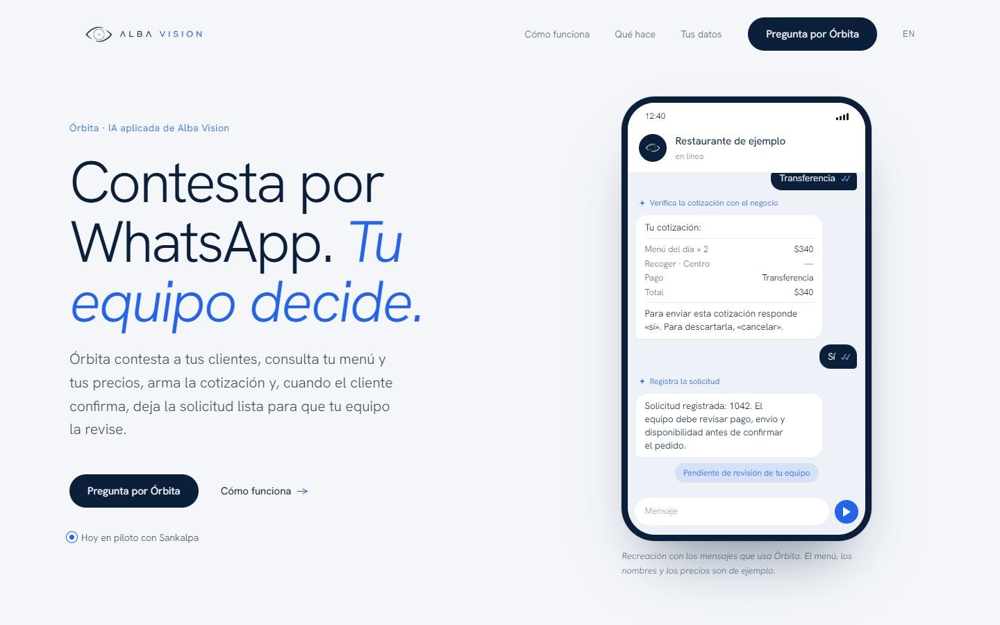
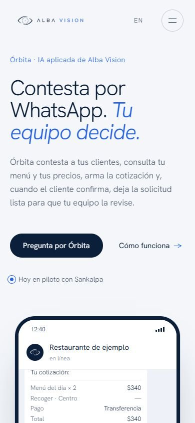
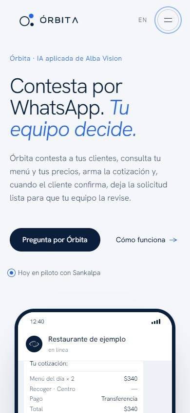
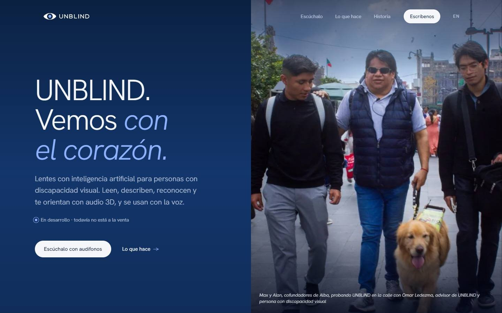
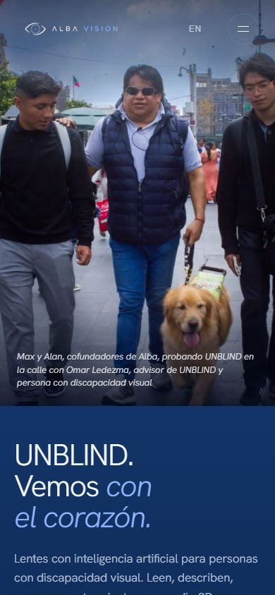
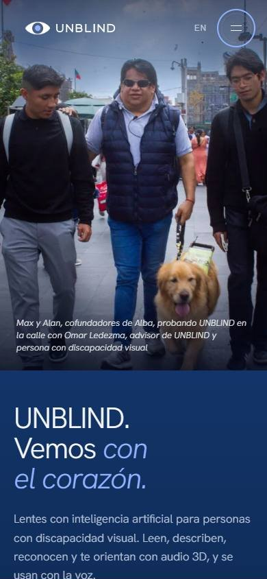
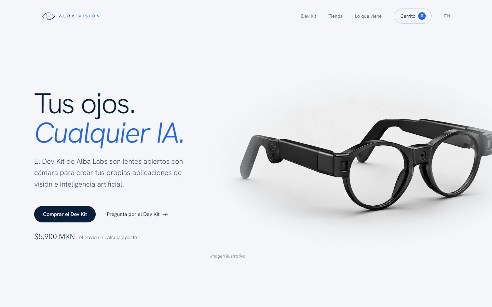
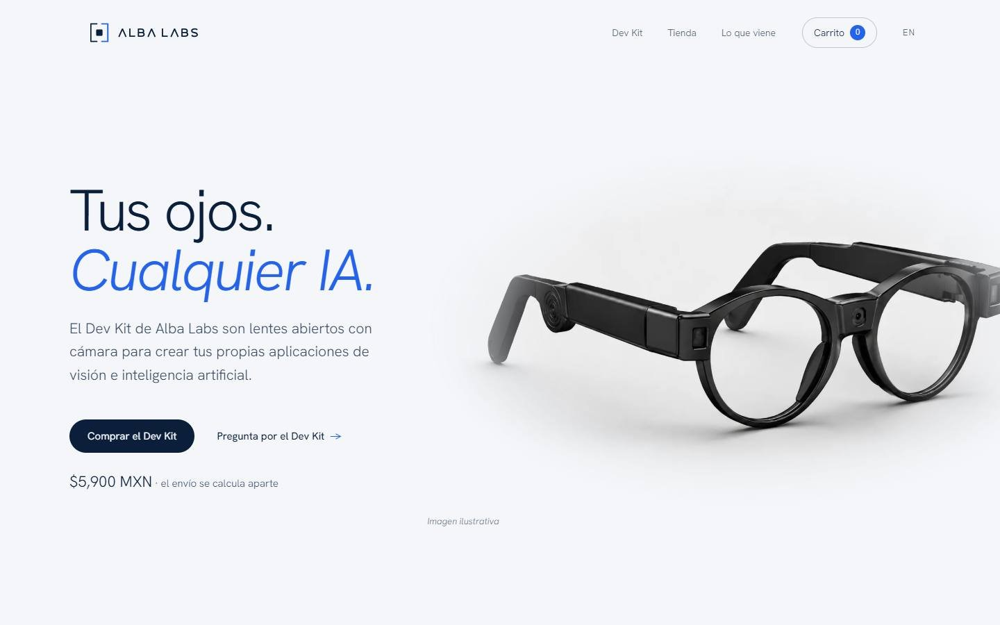
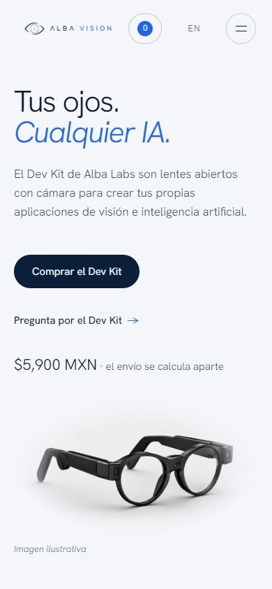
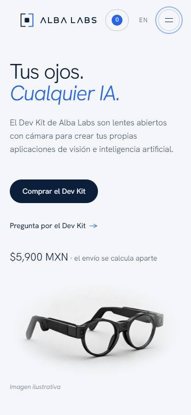

# Marca de familia · ronda 10

Las páginas de Órbita, UNBLIND y Alba Labs firmaban en el menú con la marca madre.
Ahora cada una lleva su símbolo y nombre aprobados, sin sello, y sus propios
favicon, Apple Touch e imagen para compartir. Los enlaces conservan el idioma.

Las páginas EN se regeneraron con los scripts oficiales y sus traducciones.
La portada madre, Alba Space y todos los pies conservan sus piezas. Los textos
legales de Órbita sólo cambian las dos referencias de favicon. Los recursos
anteriores quedan en `public/assets/marcas/<marca>/anterior/`.

Pruebas: extracción/generación/revisión EN correctas; 58 pruebas existentes de
Órbita y `npm run build` correctos. Chrome recorrió las diez páginas ES/EN en
1440, 1024, 390, 320 y 390×660: las 30 combinaciones de páginas cambiadas pasan;
no hubo errores de página ni recursos 4xx. El informe completo registra seis
casos con incidencias anteriores, en la portada madre y Alba Space: desbordes
de portada y controles de menú menores de 44 px. Esas páginas no se modificaron.

Se comprobaron logos claros/oscuros, menú compacto, apertura/Escape, iconos y
OG locales. No se probó teléfono físico ni caché de WhatsApp/Meta. La revisión
de Impeccable de esta integración obtuvo 19/20; los avisos del detector son
previos, contextuales o falsos positivos verificados.

## Capturas antes/después

### orbita · 1440 px

Antes:

Después:

### orbita · 390 px

Antes:

Después:

### unblind · 1440 px

Antes:

Después:

### unblind · 390 px

Antes:

Después:

### labs · 1440 px

Antes:

Después:

### labs · 390 px

Antes:

Después:

No se ejecutó merge ni despliegue. Claude revisa el PR antes de que Max decida.
